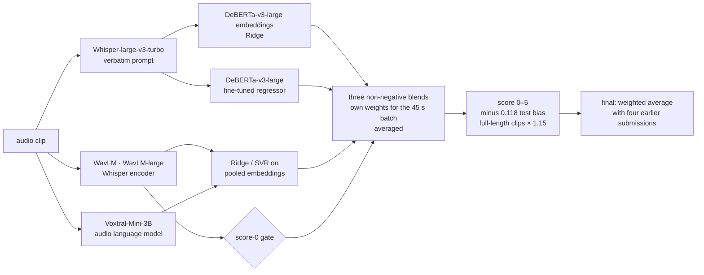

# Spoken Grammar Scoring

> What the speaker said: *"he **don't** like it"*
> What Whisper wrote: *"he **doesn't** like it"*
>
> Speech recognisers correct grammar by default, which removes the very errors this model has to score.

This repository is a solution to the **SHL Hiring Assessment 2026** Kaggle competition (`shl-hiring-assessment-2026`).
The model listens to 45–60 s of spontaneous spoken English and predicts a **0–5 grammar score**.

| | |
|---|---|
| **Best public leaderboard** | **0.3116** (lower is better; #1 is 0.3064) |
| **Main model alone** | 0.3178 (no weights tuned on the leaderboard) |
| **Training RMSE** (out-of-fold, speaker-grouped) | **0.500** |
| **Training Pearson r** (out-of-fold) | **0.915** |
| **Notebook + full report** | [`notebook/shl_grammar_scoring.ipynb`](notebook/shl_grammar_scoring.ipynb) |
| **Report (web page)** | [techy-a.github.io/shl-grammar-scoring/report](https://techy-a.github.io/shl-grammar-scoring/report/) |

---

## Approach



Every clip is judged two ways:

- **What was said.** Whisper transcribes with a prompt full of fillers and mistakes, so it keeps the speaker's errors instead of correcting them.
- **How it was said.** Frozen speech encoders capture fluency, rhythm and pronunciation. This turned out to be the strongest signal.
- **Heard by a language model.** Voxtral-Mini-3B, an audio language model, listens to the clip directly, so it hears errors that the transcript may have smoothed over. Its hidden states, combined with the WavLM, WavLM-large and Whisper-encoder embeddings in one Ridge, are the best single model (CV RMSE 0.538). The idea of using an audio language model this way comes from another participant's public solution.
- **Score-0 gate.** The WavLM model separates all 37 score-0 training clips perfectly (they are loud broadband noise with faint speech underneath, i.e. unusable recordings), so those clips are set to exactly 0.
- **A fine-tuned text model and a separate weighting for one recording batch.** Each blend also includes DeBERTa-v3-large fine-tuned as a regressor on the transcripts (trained on test-length crop transcripts, without the score-0 clips). The 45.06 s recording batch, 12% of the training clips but 40% of the test clips, gets its own blend weights, re-centred so that it gets no extra offset. Together: out-of-fold 0.510 → 0.507, public 0.3195 → 0.3175.
- **Attention pooling over Voxtral's frames.** Voxtral's frame-level states are cached once per clip, and a small attention-pooling head learns which moments matter, training on a new random test-length crop of every clip in every epoch instead of 4 fixed crops. Added to each blend: out-of-fold metric 0.3390 → 0.3340, main model public 0.3178.
- **Final average.** The submission is a weighted average of the main model (0.494) and five earlier submissions, two of them calibration probes. The weights minimise the public error predicted from the files' public scores and their label-free differences (predicted 0.3110, scored 0.3116), so this last step is tuned to the public 60% of the test clips.

## Three things that mattered more than any model

1. **Speakers repeat.** Training clips come in "speaker twins". Random CV folds let a model recognise the voice, so all validation uses **speaker-grouped folds**, tuned to be as far from training as the test set is.
2. **Test clips are shorter.** 71% of test clips are ≤ 55 s, against 26% of training clips, and less audio means a lower prediction. Training on **test-length crops** (with transcripts of the crops) was the biggest leaderboard gain: 0.3454 → 0.3350.
3. **The leaderboard metric, decoded.** Probe submissions that rescale a submission around its mean pin the score down as **0.6·RMSE + 0.4·(1 − Pearson)** on the public 60% of the test clips. Two earlier probes (v7 ± 0.2) also measured a test-set bias of **+0.118**. Removing it gave a predicted 0.3259–0.3264. Actual result: **0.3262**. The test predictions were also compressed (std 0.80, against 1.12 out-of-fold). Three more probes showed that the full-length clips should be stretched (× 1.15 around the mean: **0.3241**) and the short clips left alone (stretching them: 0.3408).
## Leaderboard progression

| Version | What changed | Public |
|---|---|---|
| v1 | text + audio blend, score-0 gate | 0.3463 |
| v2 | + SVR on audio embeddings | 0.3454 |
| v3 | + WavLM-large, Whisper encoder | 0.3550 |
| v4 | SVRs trained on test-length crops | 0.3384 |
| v6 | all models trained on 4 crops | 0.3373 |
| v7 | + text models on crop transcripts | 0.3350 |
| v7 − 0.118 | remove measured test-set bias | 0.3262 |
| full × 1.15 | stretch compressed full-length test predictions | 0.3241 |
| + Voxtral | audio language model features; 4 models, one per kind of signal | 0.3224 |
| Ridge, 3 models | one Ridge on Voxtral + all audio encoders; 3 models, one per kind of signal | 0.3207 |
| Ensemble | equal-weight average of three blends (3-model, 4-model, 3-model trained without the score-0 clips) | 0.3195 |
| + fine-tuned text | fine-tuned DeBERTa-v3-large in each blend; own blend weights for the 45 s batch | 0.3175 |
| Weighted average | the main model with three earlier submissions, weights from their public scores | 0.3158 |
| Weighted average | the same weighting over more scored files (adds a batch-offset submission) | 0.3150 |
| + attention pooling | attention-pooling head on Voxtral's frames in each blend (main model) | 0.3178 |
| **Weighted average** | **the same weighting over all scored files, incl. the new main model** | **0.3116** |

Tried and dropped: rounding to the 0.5 label grid (−0.02 on the leaderboard), a length correction, grammar-error features (T5 corrector, CoLA, GPT-2 perplexity), end-to-end fine-tuning of WavLM, stretching the short test clips, test-time augmentation over shifted audio windows, an LLM judge (Qwen3-8B) reading the transcripts against the rubric, LanguageTool error counts, Voxtral's upper layers, an offset for one recording batch, WavLM-large's layer 20 alone, clipping predictions to [2, 5], a CEFR text-difficulty classifier, Gemini grading the audio zero-shot (`src/16_gemini_judge.py`), averaging the fine-tuned text model over 9 seeds (better in CV, public worse), Voxtral-Small-24B, Phi-4-multimodal states and transcripts (`src/17_phi4mm_embed.py`), and Qwen2.5-7B with LoRA as a regressor (`06_finetune_text.py --lora`). The details are in [`submissions/README.md`](submissions/README.md).

## Pipeline

| Script | Step |
|---|---|
| `src/01_transcribe.py` | Whisper transcripts + ASR confidence (full clips and crops) |
| `src/02_text_features.py` | length-robust text statistics |
| `src/04_text_embed.py` | frozen DeBERTa-v3-large transcript embeddings |
| `src/05_audio_embed.py` | frozen WavLM / Whisper-encoder embeddings (full clips and crops) |
| `src/11_voxtral_embed.py` | Voxtral-Mini-3B hidden states over the audio (full clips and crops) |
| `src/10_speaker_folds.py` | speaker-grouped CV folds |
| `src/06_finetune_text.py` | DeBERTa-v3-large fine-tuned on the transcripts (`--crops --drop-zero`) |
| `src/19_voxtral_frames.py` | Voxtral's frame-level states of every clip (PCA to 256 dimensions) |
| `src/20_attn_pool.py` | attention-pooling head on those frames, trained on random test-length crops |
| `src/03_train.py` | CV training of LightGBM / Ridge / SVR on any feature tables |
| `src/08_blend.py` | score-0 gate + non-negative blend (`--batch`: own weights for the 45 s batch) → `artifacts/submission.csv` |

`src/common.py` holds paths and precision settings, so the same scripts run locally and on Kaggle. Each script caches its output in `artifacts/` for the next step.

## Reproducing the results

**On Kaggle (easiest).** Attach the competition data and run the notebook on a 2× T4 GPU. It rebuilds everything from raw audio in about 3.5 hours and writes `submission.csv` (the final average also reads five earlier submission files from `submissions/`).

**Locally.** Put the competition's `Dataset_Final/` under `data/`, then:

```bash
pip install -r requirements.txt
jupyter notebook notebook/shl_grammar_scoring.ipynb
```

Locally the notebook reuses the cached `artifacts/`. To run the heavy steps on Kaggle from your machine, `bash kaggle/run_job.sh <job>` uploads `src/`, runs the job as a kernel, waits and downloads the outputs.

**Checked on Kaggle.** A run of the notebook on Kaggle (CPU, from the saved GPU features) reproduces the submitted file with
correlation 0.9999 (RMS difference 0.014). The small difference comes from the attention-pooling head, a neural network
whose training does not follow exactly the same numerical path on a CPU as on a GPU; its out-of-fold RMSE was 0.571 there
against 0.576 locally, and the ensemble's 0.506 against 0.500.

> Note: GTX 16xx cards produce NaNs in fp16, so `common.py` switches them to fp32.

---

<sub>Built by Aryan Awasthi for the SHL Hiring Assessment 2026.</sub>
