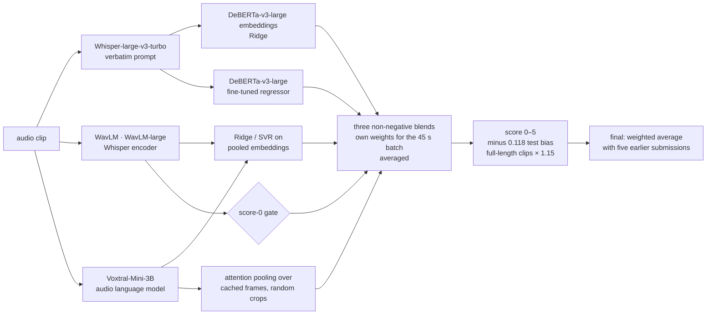

# Spoken Grammar Scoring

> What the speaker said: *"he **don't** like it"*
> What Whisper wrote: *"he **doesn't** like it"*
>
> Speech recognisers correct grammar by default, which removes the very errors this model has to score.

This repository is a solution to the **SHL Hiring Assessment 2026** Kaggle competition (`shl-hiring-assessment-2026`).
The model listens to 45–60 s of spontaneous spoken English and predicts a **0–5 grammar score**.

| | |
|---|---|
| **Best public leaderboard** | **0.3116** (lower is better; #1 is 0.3064) |
| **Main model alone** | 0.3178 (no weights tuned on the leaderboard) |
| **Training RMSE** (out-of-fold, speaker-grouped) | **0.500** |
| **Training Pearson r** (out-of-fold) | **0.915** |
| **Notebook + full report** | [`notebook/shl_grammar_scoring.ipynb`](notebook/shl_grammar_scoring.ipynb) |
| **Report (web page)** | [techy-a.github.io/shl-grammar-scoring/report](https://techy-a.github.io/shl-grammar-scoring/report/) |
| **Every submission, with its score** | [`submissions/README.md`](submissions/README.md) |

---

## Approach



- **What was said.** Whisper transcribes with a prompt full of fillers and mistakes, so it keeps the speaker's errors instead of correcting them. DeBERTa-v3-large reads the transcript, once frozen with a Ridge on top and once fine-tuned as a regressor.
- **How it was said.** Frozen speech encoders capture fluency, rhythm and pronunciation. This turned out to be the strongest signal.
- **Heard by a language model.** Voxtral-Mini-3B, an audio language model, listens to the clip directly, so it hears errors that the transcript may have smoothed over. Its hidden states, combined with the WavLM, WavLM-large and Whisper-encoder embeddings in one Ridge, are the best single model (CV RMSE 0.538). The idea of using an audio language model this way comes from another participant's public solution.
- **Attention pooling over Voxtral's frames.** Voxtral's frame-level states are cached once per clip, and a small attention-pooling head learns which moments matter, training on a new random test-length crop of every clip in every epoch.
- **Score-0 gate.** The WavLM model separates all 37 score-0 training clips perfectly (they are loud broadband noise with faint speech underneath, i.e. unusable recordings), so those clips are set to exactly 0.
- **Final average.** The submission is a weighted average of the main model (0.494) and five earlier submissions, two of them calibration probes. The weights minimise the public error predicted from the files' public scores and their label-free differences (predicted 0.3110, scored 0.3116), so this last step is tuned to the public 60% of the test clips.

---

## Research report: how the result came together

This section is the long version: what I tried, what the data kept telling me, why so many reasonable ideas did not
work, and what finally did. All scores are public leaderboard scores unless I say otherwise; lower is better.

### 1. The problem

Each example is a 45 to 60 second recording of someone answering a spoken-English prompt ("describe your school
playground", "talk about a place you like to visit"), and the label is a grammar score from 0 to 5 given by human
raters against a rubric:

| Score | What the rater looks for |
|---|---|
| 1 | Struggles with sentence structure; limited control of simple structures |
| 2 | Simple structures with consistent basic errors; incomplete sentences |
| 3 | Decent grasp of either grammar or sentence structure, with errors in the other |
| 4 | Strong control; occasional minor errors that don't impede understanding |
| 5 | High accuracy, complex structures handled well, self-corrections |

There are 769 labelled training clips and 216 test clips. That is a small dataset for a task where the signal is
spread across what was said, how it was said, and how well the sentences hold together. The competition page only
says the leaderboard uses "Pearson correlation and RMSE", and about 60% of the test clips (roughly 130) are scored on
the public leaderboard while the other 40% decide the private one.

From the start I set myself a few rules: only models with licences that allow commercial use, no external training
data (the competition forbids it), validation I can trust before any leaderboard submission, and a written log of
every experiment, including the ones that failed.

### 2. What the data looked like

Before building anything I spent time listening and counting. Several things here ended up mattering more than any
model choice.

- **The labels.** Train labels sit on a half-point grid (0, 1, 1.5, ... 5) with a mean of 3.31. Most clips score
  between 2 and 5. There are 37 clips scored exactly 0, and almost nothing between 0 and 2.
- **The score-0 clips are not bad answers.** They are recordings dominated by loud broadband noise with faint speech
  underneath. Whisper happily "transcribes" fluent English out of them, which would fool any text model. A frozen
  WavLM model separates all 37 from the rest with no false positives, so they became a separate problem with a
  separate solution: the gate.
- **Speakers repeat.** A speaker-verification model showed that many training clips come in "speaker twins". With
  random cross-validation folds, a model can partly recognise the voice instead of judging the grammar.
- **Test clips are shorter.** About 71% of test clips are 55 seconds or shorter, against 26% of training clips. Less
  audio means less evidence, and audio models systematically predict lower on shorter clips.
- **One recording batch is overrepresented in test.** 87 training clips (12%) and 84 test clips (40%) have exactly the
  same length, 45.06 seconds. They behave like a separate recording batch: scored lower, and harder for every model.
- **The test set asks new questions.** Comparing transcripts with tf-idf, 70% of training clips have a same-topic
  neighbour elsewhere in training, but only 34% of test clips have one in training. A classifier separates test from
  training audio embeddings with AUC 0.85. The test set is, in a real sense, a different domain.

### 3. A first pipeline (0.3463)

The first version described every clip by what was said (verbatim Whisper transcripts, frozen DeBERTa-v3-large
embeddings) and how it was said (frozen WavLM and Whisper-encoder embeddings, pooled over 20 second windows). The
verbatim prompt mattered: text features from it were clearly better than from plain transcription (LightGBM CV RMSE
0.771 against 0.792). Small regressors on frozen features, the score-0 gate and a non-negative linear blend gave
**0.3463**, then **0.3454** with SVRs added.

Two early lessons came from paired submissions:

- **Rounding to the label grid hurts.** Snapping predictions to the nearest 0.5 improved cross-validated MAE but made
  the public score about 0.02 worse twice. With a squared-error metric, a confident wrong half-point costs more than an
  honest 3.2. The test labels are probably averages of several raters, not grid values.
- **A better CV score does not guarantee a better public score.** Version 3 had the best cross-validated MAE and
  scored 0.3550, much worse. At the time it looked like noise. It turned out to be the first sign of the main theme of
  this project.

### 4. Fixing validation (0.3454 to 0.3350)

The biggest early gains came from making validation look like the test set, not from new models.

- **Speaker-grouped folds.** I clustered speaker embeddings so that no speaker appears on both sides of a fold. Audio
  models lost the most once voice leakage was removed, which is what you would expect if they had been partly
  recognising speakers.
- **Test-length crops.** Every training clip is also cut, from the start, to four lengths drawn from the test clips'
  own durations; every model trains on full clips plus crops and is validated on the crops. The model learns what a
  short answer from a strong speaker sounds like.
- **Crop transcripts.** The first crop version reused the full clip's transcript, which leaks words a short test clip
  never contains. Transcribing the crops themselves made the text models look worse in validation but honest, and the
  leaderboard agreed with the honest version.

| Version | Change | Public |
|---|---|---|
| v2 | frozen features, SVRs, gate | 0.3454 |
| v4 | SVRs trained on test-length crops | 0.3384 |
| v6 | every model trained on 4 crops | 0.3373 |
| v7 | text models on transcripts of the crops | **0.3350** |

This was the largest single improvement of the project, and none of it was a new architecture.

### 5. Reading the leaderboard properly (0.3350 to 0.3241)

- **A test-set bias, measured with probes.** I submitted v7 shifted by +0.2 and by -0.2. A constant shift does not
  change Pearson, so the pair of scores pins down how far the predictions sit from the test labels on average: about
  **0.118 too high**. Removing exactly that took the score from 0.3350 to **0.3262**, inside the range predicted before
  submitting (0.3259 to 0.3264). Further probes showed the bias was the same for short and full-length clips.
- **Compressed predictions.** The test predictions had a standard deviation of 0.80, against 1.12 out-of-fold on
  train. Stretching all predictions by 1.15 around the mean helped (0.3248), stretching only the short clips made
  things much worse (0.3408), and stretching only the full-length clips was best: **0.3241**. Short test clips are
  genuinely harder to tell apart; full-length ones had been squeezed toward the mean.
- **Decoding the metric.** Rescaling one submission around its mean by five factors (Pearson unchanged, only RMSE
  moves) plus one sign flip (Pearson flips) fits a single formula to five decimal places:
  **public score = 0.6 x RMSE + 0.4 x (1 - Pearson)**. From then on, every decision could be priced: what a
  calibration change could be worth, and what a gain in correlation would buy.

### 6. An audio language model (0.3241 to 0.3207)

Voxtral listens to the clip followed by the scoring rubric, and I pool the hidden states of its lower-middle layers
over the audio tokens only, dropping the tokens that only cover padding. Because the audio comes before the rubric and
attention is causal, these states depend on the audio alone. Combined with WavLM-large in one SVR it was the best
single model I had (CV RMSE 0.579) and the blend reached **0.3224**. A Ridge on Voxtral plus all the speech encoders
(12,288 features) was better again (CV RMSE 0.538), and a lean blend with one model per kind of signal scored
**0.3207**. Four models beat eight; more models of the same kind mostly added noise.

### 7. The long plateau, and why good ideas failed

For the next stretch, almost everything I tried looked better in cross-validation and scored worse on the public
leaderboard. Ten times in a row. This is the part of the project I learned the most from.

| Idea | Cross-validation | Public | Why I think it failed |
|---|---|---|---|
| More encoders (Qwen3-4B text, w2v-BERT 2.0) | RMSE 0.528 to 0.518 | 0.3341 (worse) | Extra models fitted validation quirks; the test topics are different |
| Kernel ridge with tuned per-block weights | 0.5158 to 0.5044 | 0.3290 (worse) | Weights tuned on the CV folds themselves |
| Kernel ridge with equal weights | 0.5085 | 0.3286 (worse) | Same family, no tuning, same failure |
| Training without the 37 noise clips | better in all 9 CV splits | 0.3242 vs 0.3207 | Real gain smaller than the noise; 0.3207 was a lucky draw |
| Voxtral's states after reading the rubric | better in every fold scheme | 0.3247 (worse) | A small composition change, same pattern |
| A fourth blend on other encoders | better as an ensemble member | 0.3234 (worse) | Those encoders do about 0.02 worse on the public clips than validation predicts |
| Clipping predictions to [2, 5] | P(better) = 1.00 | 0.3206 vs 0.3195 | The slow, hesitant answers predicted below 2 really are scored low |
| An offset for the 45.06 s batch | 0.528 to 0.523 | 0.3320 (worse) | The test batch answers new questions and does not behave like the train batch |
| RoBERTa-large fine-tuned instead of DeBERTa | 0.3390 to 0.3368 | 0.3225 (worse) | Same signal, different noise |
| The text fine-tune averaged over 9 seeds | 0.3390 to 0.3371 | 0.3196 vs 0.3175 | The single seed in the earlier submission happened to suit the public clips |

Many other ideas never reached a submission because validation already rejected them: an LLM judge (Qwen3-8B) scoring
transcripts against the rubric, LanguageTool error counts, a T5 grammar-correction edit rate, CoLA acceptability, a
CEFR difficulty classifier, Gemini grading the audio zero-shot, Voxtral asked for the score directly, QLoRA fine-tuning
of Voxtral, test-time augmentation over shifted audio windows, co-training on unlabelled clips, and removing topic
directions from the features. Most of them correlated well with the score on their own (the LLM judge at r = 0.62) and
almost nothing with the ensemble's *errors* (r = 0.005). A feature that measures what the ensemble already measures
cannot help it. CrisperWhisper, a Whisper model tuned for verbatim transcripts, gave no gain under topic-grouped folds
and also turned out to carry a non-commercial licence, which the rules do not allow, so it is excluded from everything
final.

Why did validation and the leaderboard disagree so often? I think five things were going on at once.

1. **The public leaderboard is small.** Around 130 clips. Resampling 130-clip subsets of the out-of-fold predictions
   shows that the score difference between two similar blends has a standard deviation of about 0.01, while most of
   the gains I was chasing were 0.002 to 0.008. Some "failures" may have been real improvements hidden by noise.
2. **The winner's curse.** Several failures were compared against 0.3207, itself the best of many submissions. The
   best of many noisy draws is usually lucky, so almost anything compared with it looks worse.
3. **Topic leakage inside cross-validation.** I built topic-grouped folds that match the test set's topic distance.
   They changed some rankings, but models that won under them still failed publicly (the kernel models won every fold
   scheme and lost every time).
4. **Covariate shift.** Weighting training clips by how test-like they look helped only on a test-weighted score and
   hurt every plain fold scheme.
5. **Composition changes overfit, procedure changes transfer.** The changes that reached the leaderboard were changes
   to *how* models were trained or corrected (crops, crop transcripts, the bias fix, the stretch, a genuinely new
   signal). The ones that failed were mostly changes to *which* models went into the blend, chosen by the same
   validation that then judged them.

The working rule I took from this: a change has to be better in validation **and** of the kind that has transferred
before. Anything that differs from the current best only by blend composition is suspect.

### 8. Ensembles and the averaging identity (0.3207 to 0.3150)

For squared error, for two prediction files a and b:

> mean((a + b)/2 - y)^2 = 1/2 MSE(a) + 1/2 MSE(b) - 1/4 mean((a - b)^2)

The first two terms come from the files' public scores and the last needs no labels, so the public score of an average
can be **predicted before submitting it**. The more two decent files disagree, the more their average gains.

- An equal-weight average of three blends was predicted at 0.3196 and scored **0.3195**.
- With a fine-tuned DeBERTa-v3-large added to each blend and separate blend weights for the 45.06 s batch (re-centred
  so the batch gets no extra offset, since a plain offset had failed), the main model reached **0.3175**. On that batch
  the blends drop the WavLM SVR, which falls apart there, and lean on the text models and the Voxtral ridge.
- The identity extends to any weighted mix: with G_ij = (MSE_i + MSE_j - mean((p_i - p_j)^2)) / 2, the public MSE of a
  mix is w'Gw. Non-negative weights that minimise it over my scored submissions gave 0.3158 and then **0.3150**.

These weights are fitted to public scores, so I treat that step as tuned to the public 60% of the test clips and
report the main model's own score next to it everywhere. One detail mattered: shift probes do not change Pearson, so
their scores convert to RMSE exactly as (score - 0.4 x (1 - r)) / 0.6, not in proportion. Over the whole project the
mix predictions landed within 0.0005 of the real score every time (0.3196 vs 0.3195, 0.3153 vs 0.3158, 0.3145 vs
0.3150, 0.3132 vs 0.3134, 0.3110 vs 0.3116).

### 9. The last push (0.3150 to 0.3116)

At this point I stepped back and reviewed the problem from four directions: the metric and leaderboard, the audio side,
the text side, and the statistics of what could transfer. The conclusions were consistent. There was no honest metric
trick left (probing the public bias of groups of test files would have gained a little publicly, cost about as much
privately, and amounts to leaderboard gaming, so I did not do it). The largest remaining pool of error was the 45.06 s
batch, where the blend's correlation with the labels was only 0.74 against 0.86 elsewhere. And frozen features from new
models were probably exhausted: the next gain had to come from a change in how a model is trained.

I tested "more compute" directly before believing it would not help:

| Attempt | Result |
|---|---|
| Voxtral-Small-24B (4-bit) instead of Voxtral-Mini-3B | Weaker features (ridge 0.615 vs 0.601) |
| Phi-4-multimodal hidden states (a second audio language model) | Weaker (0.668) and no blend gain |
| Phi-4 transcripts for the text model | Kept more grammar errors, but correlated 0.95 with Whisper's |
| Qwen2.5-7B with LoRA as a regressor on transcripts | Two pilot folds no better than DeBERTa; correlation 0.03 with the blend's errors |
| Task-adaptive pretraining of DeBERTa on all transcripts | Correlation 0.96 with the existing fine-tune, no gain |

With 769 labelled clips, a bigger model mostly learns what the smaller ones already know.

**What worked was attention pooling over Voxtral's frames.** Every audio model so far had seen each clip as one summary
vector and had been trained on four fixed crops. I changed both:

1. **Cache the frames once.** For every clip, Voxtral's frame-level states (12.5 per second, the same lower-middle
   layers, compressed to 256 dimensions by PCA) are stored. Voxtral's language model attends causally and a crop is a
   prefix of the clip, so a crop's frames are a prefix of the clip's frames; against real crop embeddings the median
   per-clip correlation is 0.997.
2. **Learn where to listen.** A small head (a projection, an attention-weighted average over time, plus the plain mean
   and standard deviation) learns which moments in the answer carry the grammar evidence.
3. **Train on a new random crop every epoch.** Instead of four fixed crops, the head sees a fresh test-length prefix
   of every clip in every epoch. It is the crop idea from section 4 pushed much further, at no extra GPU cost.

Alone, the head was slightly better than the Ridge on the same features (RMSE 0.576 against 0.584 on the scored
clips), and unlike every other recent idea its errors differed from the blend's (correlation 0.078 with the residuals,
where everything else had been below 0.03). Added to each blend it gave the largest validation gain since the
fine-tuned text model: out-of-fold metric 0.3390 to **0.3340**, bootstrap probability of a real gain 0.96. The main
model with it scored **0.3178**, and the weighted mix over all scored files, now including it, was predicted at 0.3110
and scored **0.3116**.

The same trick on Phi-4 and WavLM-large frames made the blends worse, training the head twice as long overfitted, and
nine seeds instead of three helped validation slightly (0.3340 to 0.3323) but changed the predictions too little to
matter.

### 10. The full journey

| Version | What changed | Public |
|---|---|---|
| v1 | text + audio blend, score-0 gate | 0.3463 |
| v2 | + SVR on audio embeddings | 0.3454 |
| v3 | + WavLM-large, Whisper encoder | 0.3550 |
| v4 | SVRs trained on test-length crops | 0.3384 |
| v6 | all models trained on 4 crops | 0.3373 |
| v7 | + text models on crop transcripts | 0.3350 |
| v7 − 0.118 | remove measured test-set bias | 0.3262 |
| full × 1.15 | stretch compressed full-length test predictions | 0.3241 |
| + Voxtral | audio language model features; 4 models, one per kind of signal | 0.3224 |
| Ridge, 3 models | one Ridge on Voxtral + all audio encoders | 0.3207 |
| Ensemble | equal-weight average of three blends | 0.3195 |
| + fine-tuned text | fine-tuned DeBERTa-v3-large in each blend; own blend weights for the 45 s batch | 0.3175 |
| Weighted average | the main model with earlier submissions, weights from their public scores | 0.3150 |
| + attention pooling | attention-pooling head on Voxtral's frames in each blend (main model) | 0.3178 |
| **Weighted average** | **the same weighting over all scored files, incl. the new main model** | **0.3116** |

| Component | What it contributes | Alone (CV RMSE) |
|---|---|---|
| Transcript Ridge (DeBERTa-v3-large, frozen) | Words and sentence structure | 0.77 on all clips |
| Fine-tuned DeBERTa-v3-large | The same text, learned end to end | 0.59 on scored clips |
| Ridge on Voxtral + WavLM + WavLM-large + Whisper encoder | The strongest single view | 0.54 |
| WavLM-large SVR | Fluency, rhythm, pronunciation | 0.60 |
| Attention pooling on Voxtral frames | Which moments matter, trained on many crops | 0.58 on scored clips |
| WavLM gate | Sets the noise recordings to 0 | catches all 37 |

### 11. What I learned

1. **Validation design beats architecture.** Speaker-grouped folds and test-length crops did more than any model.
2. **The leaderboard is an instrument, not an oracle.** Probes measured the bias and decoded the metric, and the
   averaging identity predicted scores before I spent submissions. Used naively, a 130-clip leaderboard mostly reports
   noise.
3. **Correlation with the target is not usefulness.** An LLM judge correlating 0.62 with the score added nothing,
   while a weaker model whose errors differ from the ensemble's added the most. The number that matters is the
   correlation with the current model's errors.
4. **Procedure changes transfer, composition changes overfit.** Ten validation gains from reshuffling the blend failed
   publicly; the gains that held came from changing how models were trained.
5. **Bigger is not better with 769 labels.** A 24B audio model, a 7B LLM and nine seeds all lost to a small attention
   head trained the right way.
6. **Write everything down.** The log of failures is what made point 4 visible.

### 12. Limitations and next steps

- **Small data.** 769 clips and about 130 public test clips; differences under about 0.01 between similar models are
  mostly noise, and the private 40% will reshuffle close scores.
- **Public tuning.** The final mix uses weights fitted to public scores, so part of its edge over the main model
  (0.3178 against 0.3116) may shrink on the private clips. That is why both numbers are reported.
- **Domain shift.** Test clips answer new questions and come largely from one recording batch that the models find
  hard (within-batch correlation about 0.80 against 0.93 for full-length clips).
- **Extremes.** Predictions are pulled toward the mean, so the largest errors are at scores 1.5 to 2 and at 5.

With more time I would try a head that reads the transcript and the audio frames together, model the 45.06 s batch
more directly, and, outside a competition, collect more labelled data at the extreme scores. The notebook includes a
fairness check by recording group; with demographic labels it should extend to gender, age and first language, which
matters for any real assessment use.

---

## Pipeline

| Script | Step |
|---|---|
| `src/01_transcribe.py` | Whisper transcripts + ASR confidence (full clips and crops) |
| `src/02_text_features.py` | length-robust text statistics |
| `src/04_text_embed.py` | frozen DeBERTa-v3-large transcript embeddings |
| `src/05_audio_embed.py` | frozen WavLM / Whisper-encoder embeddings (full clips and crops) |
| `src/11_voxtral_embed.py` | Voxtral-Mini-3B hidden states over the audio (full clips and crops) |
| `src/10_speaker_folds.py` | speaker-grouped CV folds |
| `src/06_finetune_text.py` | DeBERTa-v3-large fine-tuned on the transcripts (`--crops --drop-zero`) |
| `src/19_voxtral_frames.py` | Voxtral's frame-level states of every clip (PCA to 256 dimensions) |
| `src/20_attn_pool.py` | attention-pooling head on those frames, trained on random test-length crops |
| `src/03_train.py` | CV training of LightGBM / Ridge / SVR on any feature tables |
| `src/08_blend.py` | score-0 gate + non-negative blend (`--batch`: own weights for the 45 s batch) → `artifacts/submission.csv` |

`src/common.py` holds paths and precision settings, so the same scripts run locally and on Kaggle. Each script caches
its output in `artifacts/` for the next step. Scripts not in the table (`07`, `09`, `12`–`18`) are experiments described
in the research report above and in `submissions/README.md`.

## Reproducing the results

**On Kaggle (easiest).** Attach the competition data and run the notebook on a 2× T4 GPU. It rebuilds everything from raw audio in about 3.5 hours and writes `submission.csv` (the final average also reads five earlier submission files from `submissions/`).

**Locally.** Put the competition's `Dataset_Final/` under `data/`, then:

```bash
pip install -r requirements.txt
jupyter notebook notebook/shl_grammar_scoring.ipynb
```

Locally the notebook reuses the cached `artifacts/`. To run the heavy steps on Kaggle from your machine, `bash kaggle/run_job.sh <job>` uploads `src/`, runs the job as a kernel, waits and downloads the outputs.

**Checked on Kaggle.** A run of the notebook on Kaggle (CPU, from the saved GPU features) reproduces the submitted file with
correlation 0.9999 (RMS difference 0.014). The small difference comes from the attention-pooling head, a neural network
whose training does not follow exactly the same numerical path on a CPU as on a GPU; its out-of-fold RMSE was 0.571 there
against 0.576 locally, and the ensemble's 0.506 against 0.500.

> Note: GTX 16xx cards produce NaNs in fp16, so `common.py` switches them to fp32.

---

<sub>Built by Aryan Awasthi for the SHL Hiring Assessment 2026.</sub>
